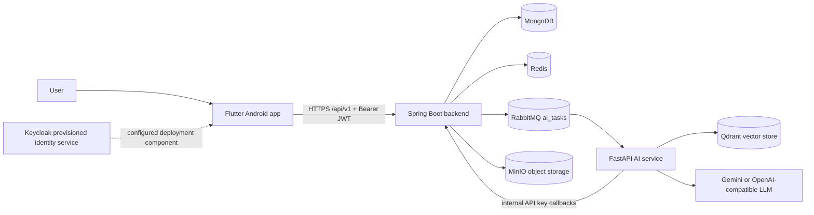
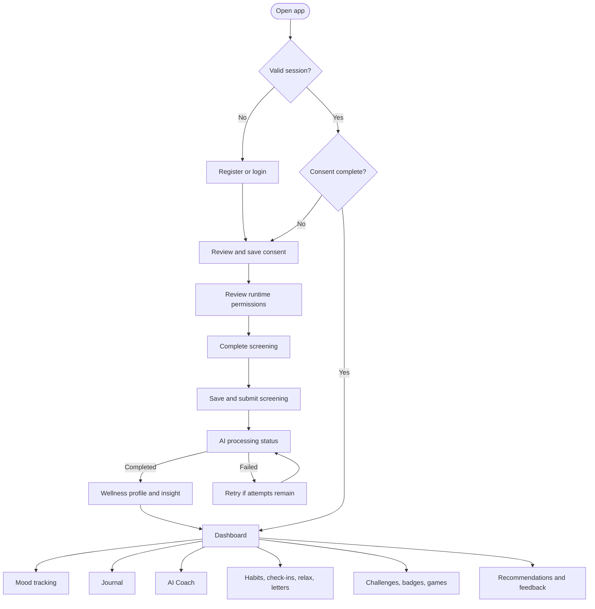
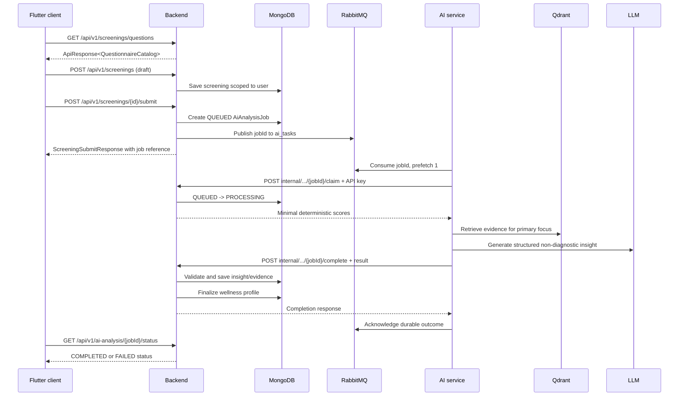
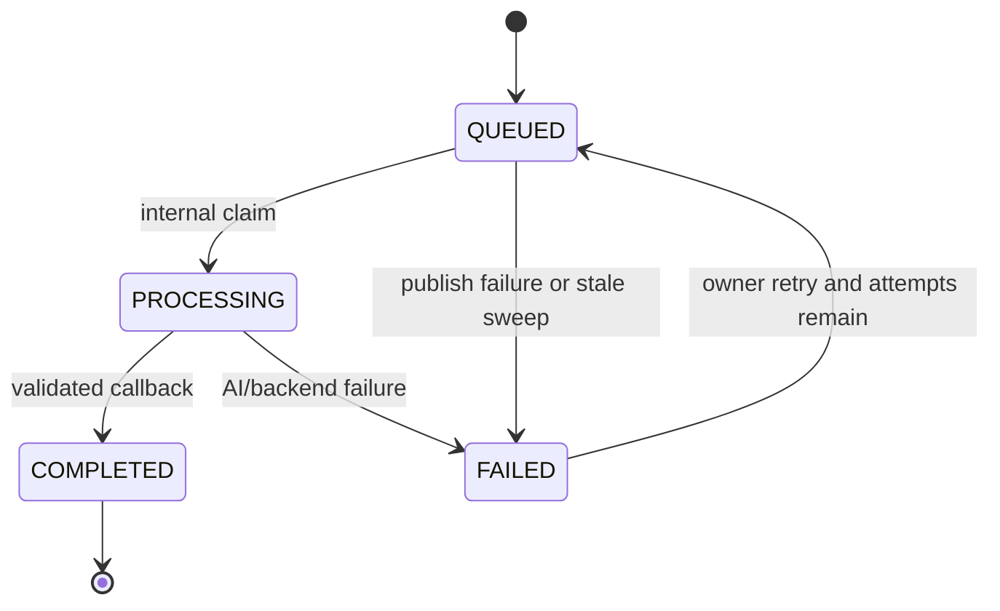
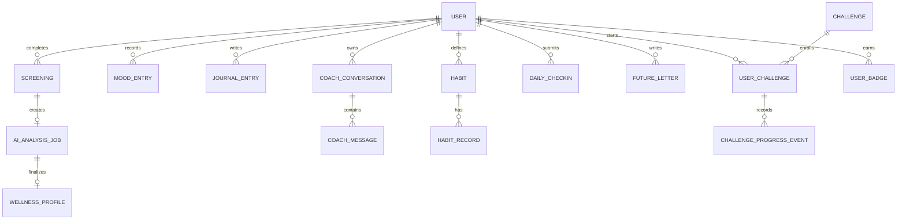

# Synora / MindEase Project Documentation

**Document purpose:** academic reference, development hand-off, deployment guide, and production review

**System status:** implemented multi-service prototype with production-oriented containerization and test coverage

**Last verified against source:** 2026-09-12

## 1. Executive Summary

Synora (also named MindEase in package, container, and application identifiers) is a mobile mental-health screening and support-guidance platform. It is designed to help a user complete validated-style wellness questionnaires, record ongoing mood and journal information, receive non-diagnostic AI-generated guidance, and build healthy routines through recommendations, habits, relaxation activities, challenges, and games.

The system is composed of:

- A Flutter mobile client in `app/`.
- A Spring Boot 3 REST backend in `backend/`.
- A FastAPI AI service in `ai-service/`.
- MongoDB for primary data, Redis for cache/rate-limit support, RabbitMQ for asynchronous AI jobs, Qdrant for retrieval-augmented generation, and MinIO for media objects.
- Keycloak as a provisioned identity-management component, while the currently implemented backend request path uses self-issued HMAC JWT authentication. This distinction is important for production integration.

The primary screening workflow is asynchronous. The backend stores the screening and creates an AI analysis job. RabbitMQ delivers the job to the AI service, which validates anonymized scores, retrieves evidence, generates a constrained insight, and calls an authenticated backend callback. The backend validates the result again before storing it and updating the user wellness profile.

This product provides support guidance, not clinical diagnosis, emergency response, or a substitute for a qualified professional. High-risk signals should be surfaced with an appropriate crisis and professional-support policy before production release.

## 2. Scope and Goals

### 2.1 In scope

1. Secure account registration, login, refresh, logout, password reset, consent, and permission onboarding.
2. Questionnaire-driven mental-health screening with saved drafts and asynchronous AI analysis.
3. Personal wellness profile, dashboard, progress, and personalization context.
4. Manual, text, and camera-assisted mood analysis and mood history.
5. Journal CRUD, optional media attachments, and journal analysis.
6. AI Coach conversations, safety classification, and evidence retrieval.
7. Recommendations, feedback, habits, check-ins, relaxation activities, future letters, challenges, badges, progress, and local games.
8. Containerized development and production deployment.
9. Testable module boundaries, health checks, rate limiting, job retry, stale-job recovery, and observability metrics.

### 2.2 Out of scope or not established by the implementation

- Clinical diagnosis, treatment planning, clinician access, or medical-record interoperability.
- A demonstrated production Keycloak-to-backend OIDC/JWKS authentication path. Keycloak is provisioned, but the source currently authenticates with its own JWT service.
- A complete automated Flutter-to-backend-to-RabbitMQ-to-AI end-to-end test.
- Guaranteed crisis intervention, human escalation, or emergency-service integration.
- Proof that every recommendation path uses an LLM: the current `AIRouter` selects `FallbackRecommender` for its recommender abstraction.

## 3. Requirements

### 3.1 Actors

| Actor | Responsibilities |
|---|---|
| End user | Creates an account, gives consent, completes screening, records wellbeing activity, reads guidance, and manages personal data. |
| Mobile client | Presents workflows, validates input, stores session tokens securely, requests permissions, and calls the backend. |
| Backend API | Owns authentication, authorization, user data, workflow state, persistence, job lifecycle, and media access. |
| AI service | Performs bounded analysis, retrieval, LLM orchestration, safety classification, and asynchronous job callbacks. |
| Operations administrator | Configures secrets, manages infrastructure, observes health and metrics, seeds the knowledge base, and handles incidents. |
| Knowledge-base curator | Maintains trusted guidance sources under `knowledge-base/`. |

### 3.2 Functional requirements

| ID | Requirement | Implemented behavior / acceptance indication |
|---|---|---|
| FR-01 | Account lifecycle | Register, login, refresh, logout, forgot password, OTP verification, and reset password are exposed under `/api/v1/auth`. |
| FR-02 | Consent and permissions | Consent is persisted through `/api/v1/consent`; Flutter gates the journey and manages camera, microphone, storage, and notification permissions. |
| FR-03 | Screening | The client retrieves questionnaire catalog data, saves a draft, submits once, and polls an owner-scoped AI job status. |
| FR-04 | AI screening result | Screening scores are validated, anonymized before LLM processing, grounded with retrieved evidence, and stored only after backend validation. |
| FR-05 | Mood tracking | Users can record, list, inspect, update, delete, analyze, and view recent/statistical/trend mood data. |
| FR-06 | Multimodal mood | Manual mood, text, and camera observations can contribute to mood analysis. The client contains face detection and TFLite model assets. |
| FR-07 | Journaling | Users can create, read, update, delete, search/filter, attach media metadata, and retry journal analysis. |
| FR-08 | Coaching | Users can create conversations, list/delete conversations, read messages, and add messages; safety and wellness retrieval are AI-service capabilities. |
| FR-09 | Personalization | Dashboard, progress, recommendation feedback, context refresh, and interaction history are available. |
| FR-10 | Wellness routines | Habits, habit records, daily check-ins, relaxation activities, future letters, recommendations, challenges, badges, and progress are modeled. |
| FR-11 | Games | 2048, Sudoku, Tic-Tac-Toe, and memory match are available locally and can report challenge progress/results. |
| FR-12 | Media | Backend media endpoints issue upload/delete behavior backed by MinIO-compatible object storage. |
| FR-13 | Reliability | AI jobs support idempotent submission, bounded attempts, retry, stale-job sweeping, callback validation, and durable queue acknowledgement. |
| FR-14 | Operations | Services provide Docker health checks; backend exposes Actuator health and AI exposes `/health`. |

### 3.3 Non-functional requirements

| Category | Requirement |
|---|---|
| Security | Use TLS at every external boundary, protect secrets, scope all user data by authenticated user ID, authenticate internal callbacks, and never expose internal infrastructure publicly. |
| Privacy | Send only the minimal deterministic screening scores to the LLM job path; avoid raw questionnaire answers in prompts; define retention and deletion policies before production. |
| Availability | Keep asynchronous AI work independent of request latency; reconnect RabbitMQ with backoff; recover stale jobs; use container restart policies in production. |
| Performance | Use Redis and indexed Mongo queries where configured; RabbitMQ uses `prefetch_count=1`; direct AI routes are rate limited. |
| Maintainability | Preserve feature modules and layered boundaries; keep AI engines behind protocols; version APIs under `/api/v1`. |
| Accessibility | Provide clear onboarding, permission explanations, readable status/error states, and a non-camera/manual path for mood entry. |
| Auditability | Emit structured logs and Micrometer job counters/timers; record job status, attempts, evidence sources, and timestamps. |
| Portability | Run services through Docker Compose; keep LLM, embedding, and storage providers configurable. |

## 4. System Architecture



### 4.1 Service responsibilities

**Flutter client.** Feature-based presentation, state controllers using `ChangeNotifier`, GoRouter navigation, Dio networking, encrypted token storage, permission handling, camera/face detection, TFLite inference, media capture, and local game logic.

**Spring Boot backend.** The system of record for identity, consent, screening, user-owned data, domain workflows, media authorization, AI job lifecycle, internal callback validation, and API envelopes. Feature code is organized into API, application, domain, and persistence layers.

**FastAPI AI service.** Exposes bounded analysis endpoints and consumes `ai_tasks`. It contains emotion, risk, mood, journal, RAG, recommendation, coach, LLM, and rate-limit components. Interfaces allow provider replacement without changing HTTP orchestration.

**Infrastructure.** MongoDB persists documents; Redis supports cache/rate limiting; RabbitMQ transports durable work; Qdrant stores embeddings; MinIO stores files; Keycloak is available for identity administration and realm import.

### 4.2 Network topology

- `frontend` connects the host-facing backend, AI service in development, and Keycloak.
- `internal` is marked internal and connects backend, AI service, MongoDB, Redis, RabbitMQ, Qdrant, and MinIO.
- Development publishes debug ports on loopback where configured.
- Production removes host-published AI and infrastructure ports and applies restart/resource policies.

### 4.3 Backend layering

```text
modules/<feature>/
  api/          REST controllers and DTO mapping
  application/ use cases and business rules
  domain/      entities, value objects, repository contracts
  persistence/ Spring Data Mongo adapters
common/        response, errors, logging
config/        security and infrastructure configuration
```

### 4.4 AI layering

```text
app/api/v1/endpoints/   HTTP routes
app/schemas/            Pydantic contracts
app/core/               risk, mood, emotion, RAG, recommendation, LLM engines
app/services/           orchestration and RabbitMQ consumer
app/config.py           environment-driven settings
```

## 5. User Experience and User Flow



### 5.1 Main product journeys

**Onboarding:** welcome -> register/login -> consent -> permissions -> screening -> AI processing -> wellness profile -> dashboard.

**Daily wellbeing:** dashboard -> check-in or manual mood -> optional text/camera analysis -> save mood -> trend/statistics -> recommendation or relaxation activity.

**Reflective journaling:** journal home -> create entry -> optional image/audio/video metadata upload -> save -> view analysis -> edit/delete -> retry analysis when needed.

**AI Coach:** coach home -> create/select conversation -> send message -> safety classification and wellness context -> persist message -> show bounded response -> conversation history.

**Challenge:** challenge home -> inspect challenge -> start -> play local game or complete activity -> submit progress -> complete -> award badge/update streak/history.

## 6. End-to-End Workflows

### 6.1 Screening and AI analysis



Job state machine:



Important guarantees:

- Duplicate screening submission reuses the existing job for the assessment.
- The job owner alone can query status or retry.
- Completed jobs cannot be reprocessed.
- The AI service sees deterministic scores, not raw questionnaire answers, in the asynchronous LLM path.
- Both the AI service and backend reject blank, too-short, too-long, or diagnosis-like insight text.

### 6.2 Mood analysis

1. The user supplies a manual mood, text, camera observation, or a combination.
2. Text analysis uses emotion/sentiment models with a rule-based fallback.
3. Camera input is structured from on-device face detection and TFLite emotion classification.
4. Fusion uses the documented weights: manual `0.50`, text `0.25`, camera `0.25`.
5. Confidence and confirmation logic produce an analysis response.
6. The backend persists the selected mood and exposes recent entries, statistics, and trends.

### 6.3 Journal media workflow

1. The client requests media upload handling through the backend.
2. The backend authorizes the user and uses MinIO-compatible storage.
3. The client captures/selects image, audio, or video and records the returned object reference.
4. The journal entry stores text, media metadata, and analysis state.
5. Analysis can be displayed or retried without changing the journal ownership boundary.

### 6.4 Failure and recovery workflow

- AI transport failures are retried in the LLM client and bounded at the insight-validation layer.
- RabbitMQ connection failures reconnect with backoff.
- Backend callback failures are retried by the consumer; transient failures are requeued.
- A stale-job sweeper marks abandoned `PROCESSING` or never-started `QUEUED` jobs as failed.
- An owner can retry a failed job while its attempt count is below `maxAttempts`.
- Publish failures are persisted as `FAILED` rather than leaving a misleading queued state.

## 7. Feature Catalogue

| Area | Capabilities | Primary API surface |
|---|---|---|
| Authentication | Registration, login, refresh, logout, password reset | `/api/v1/auth` |
| Consent/profile | Consent, current user, wellness profile | `/api/v1/consent`, `/api/v1/users/me`, `/api/v1/wellness-profile` |
| Screening | Catalog, draft CRUD, submit, history | `/api/v1/screenings` |
| AI status | Status and retry | `/api/v1/ai-analysis` |
| Dashboard | Personalized summary and progress | `/api/v1/dashboard`, `/api/v1/progress` |
| Mood | CRUD, analysis, recent, stats, trends | `/api/v1/moods` |
| Journal | CRUD, media, analysis retry | `/api/v1/journals`, `/api/v1/media` |
| AI Coach | Conversations and messages | `/api/v1/conversations` |
| Recommendations | List, details, feedback, interactions | `/api/v1/recommendations` |
| Personalization | Context, refresh, feedback history | `/api/v1/personalization` |
| Habits/check-ins | Habit CRUD/records/progress and daily check-ins | `/api/v1/habits`, `/api/v1/check-ins` |
| Relaxation | Browse, details, completion | `/api/v1/relax` |
| Future letters | CRUD, scheduled/delivered, open | `/api/v1/future-letters` |
| Challenges | Browse, start, progress, complete, badges/history | `/api/v1/challenges` |

## 8. API Reference

### 8.1 Conventions

- Backend base path: `/api/v1`.
- Successful backend responses use `{ "success": true, "data": ..., "timestamp": "..." }`.
- Authenticated backend routes expect `Authorization: Bearer <JWT>`.
- User resource IDs are checked against the authenticated user server-side.
- Internal AI callbacks use `X-Internal-Api-Key` and are not user-facing routes.
- AI service base path: `/api/v1`; operational health is `GET /health`.
- AI HTTP routes use IP-based rate limiting via `rate_limited`; they are host-published only in development and should remain network-internal in production.

### 8.2 Backend endpoint catalogue

| Method | Path | Purpose |
|---|---|---|
| POST | `/auth/register` | Create account |
| POST | `/auth/login` | Authenticate and issue session tokens |
| POST | `/auth/refresh` | Refresh access token |
| POST | `/auth/logout` | End session |
| POST | `/auth/forgot-password` | Start OTP reset flow |
| POST | `/auth/verify-otp` | Verify reset OTP |
| POST | `/auth/reset-password` | Set a new password |
| GET/POST | `/consent` | Read or save consent |
| GET | `/users/me` | Read current user |
| GET | `/wellness-profile` | Read current wellness profile |
| GET | `/screenings/questions` | Read current questionnaire catalog |
| POST/GET | `/screenings`, `/screenings/me` | Create or list screenings |
| GET/PUT | `/screenings/{id}` | Read or update a screening |
| POST | `/screenings/{id}/submit` | Submit screening and create AI job |
| GET/POST | `/ai-analysis/{jobId}/status`, `/ai-analysis/{jobId}/retry` | Read or retry owned AI job |
| POST | `/internal/ai-analysis/{jobId}/claim` | AI claims queued job |
| POST | `/internal/ai-analysis/{jobId}/complete` | AI submits validated result |
| POST | `/internal/ai-analysis/{jobId}/fail` | AI reports failure |
| GET/POST/PUT/DELETE | `/moods` and `/moods/{id}` | Mood CRUD |
| POST | `/moods/analyze` | Analyze mood signals |
| GET | `/moods/recent`, `/moods/stats`, `/moods/trends`, `/moods/trends/enhanced` | Mood summaries |
| GET/POST/PUT/DELETE | `/journals` and `/journals/{id}` | Journal CRUD |
| POST | `/journals/{id}/analysis/retry` | Retry journal analysis |
| POST/GET/DELETE | `/conversations`, `/conversations/{id}` | Coach conversation lifecycle |
| GET/POST | `/conversations/{id}/messages` | Read or add coach messages |
| GET | `/recommendations`, `/recommendations/{id}` | Read guidance |
| POST | `/recommendations/{id}/feedback`, `/recommendations/{id}/interaction` | Record feedback and interaction |
| GET/POST | `/personalization/context`, `/personalization/context/refresh` | Read or refresh context |
| POST/GET | `/personalization/feedback`, `/personalization/feedback` | Record/read personalization feedback |
| GET | `/dashboard`, `/progress` | Read user summary and progress |
| GET/POST/PUT/DELETE | `/habits` and `/habits/{id}` | Habit lifecycle |
| GET/POST | `/habits/{id}/records`, `/habits/weekly-progress`, `/habits/monthly-progress` | Habit records and aggregates |
| GET/POST/PUT | `/check-ins`, `/check-ins/today`, `/check-ins/{id}` | Daily check-ins |
| GET/POST/PUT/DELETE | `/future-letters` and `/future-letters/{id}` | Future-letter lifecycle |
| GET | `/future-letters/scheduled`, `/future-letters/delivered` | Letter state views |
| PUT | `/future-letters/{id}/open` | Open delivered letter |
| GET | `/relax`, `/relax/{id}` | Browse relaxation activities |
| POST | `/relax/{id}/complete` | Record completion |
| GET | `/challenges/home`, `/challenges`, `/challenges/{id}` | Challenge discovery |
| POST | `/challenges/{id}/start`, `/challenges/{id}/progress`, `/challenges/{id}/complete` | Challenge lifecycle |
| GET | `/challenges/badges`, `/challenges/history`, `/challenges/progress` | Challenge summaries |
| POST/DELETE | `/media/upload`, `/media` | Media upload/delete handling |

### 8.3 AI service endpoint catalogue

All routes below are under `/api/v1` and rate limited.

| Method | Path | Purpose |
|---|---|---|
| POST | `/screening/analyze` | Direct screening risk analysis; returns an intermediate queued-for-LLM status |
| POST | `/mood/text` | Text mood analysis |
| POST | `/mood/camera` | Camera observation analysis |
| POST | `/mood/analyze` | Multimodal mood fusion |
| POST | `/journal/analyze` | Journal emotion/themes/summary analysis |
| POST | `/risk/assess` | Heuristic risk assessment from scores and flags |
| POST | `/rag/retrieve` | Retrieve evidence chunks from Qdrant |
| POST | `/recommendations/generate` | Generate or return recommendations |
| POST | `/coach/safety/classify` | Classify coach-message safety signals |
| POST | `/coach/wellness/retrieve` | Retrieve coach wellness content |
| GET | `/health` | AI service health check, outside the versioned API prefix |

## 9. Data and Database Design

MongoDB is the primary persistence store. The application uses document entities and Spring Data repositories, with ownership and lifecycle fields handled in the domain/application layers. Collection names should be confirmed from the active entity mapping before a migration is treated as final.

### 9.1 Logical collections

| Collection / aggregate | Purpose and important relationships |
|---|---|
| `users` | Account identity and user profile root. Referenced by most user-owned aggregates. |
| `refresh_tokens` | Refresh-token lifecycle and revocation. |
| `password_reset` | OTP/reset state with expiry and delivery metadata. |
| `consents` | Versioned or timestamped consent decision. |
| `questionnaire_catalog` | Current screening questions and scoring metadata. |
| `screenings` | User drafts/submissions and deterministic scores. |
| `ai_analysis_jobs` | Assessment job, owner, status, attempts, insight, evidence, timestamps, and error. |
| `wellness_profiles` | Finalized screening-derived wellness profile and insight. |
| `mood_entries` | User mood observations and analysis signals. |
| `journal_entries` | User-authored text/media metadata and analysis state. |
| `coach_conversations`, `coach_messages`, `coach_memories` | Conversation threads, messages, and retained personalization context. |
| `recommendation_content`, `recommendation_interactions` | Guidance content and user feedback/use events. |
| `personalized_contexts`, `personalization_feedback` | Materialized user signals and explicit feedback. |
| `habits`, `habit_records` | Habit definitions and dated completion records. |
| `daily_checkins` | Daily wellbeing check-in responses. |
| `future_letters` | User-authored letters and scheduled/delivered/open state. |
| `challenges`, `user_challenges`, `challenge_progress_events`, `user_badges` | Challenge catalog, enrollment, progress events, and earned badges. |
| `relax_activities`, `user_relax_completions` | Relaxation content and completion history. |
| `tenants` | Tenant boundary support where enabled. |

### 9.2 Logical relationship model



### 9.3 Data lifecycle principles

- User-owned reads and writes must derive the owner from the authenticated request, not from an arbitrary client-supplied owner ID.
- AI job status and retry operations are owner-scoped.
- Raw answers should not be sent to the LLM when deterministic scores are sufficient.
- Media objects need private bucket policy, signed URLs, content-type/size limits, malware scanning, and deletion semantics before production.
- Retention, export, account deletion, and consent withdrawal require an explicit product policy and implementation review.

## 10. AI Components

### 10.1 Screening risk and insight

- `ScreeningScoresInput` strictly bounds PHQ-9, GAD-7, PSS-10, WHO-5, wellness, lifestyle, stress, sleep, and primary-focus inputs.
- `HeuristicRiskAssessor` uses screening thresholds and contextual flags such as suicide/self-harm indicators.
- Qdrant retrieval uses `sentence-transformers/all-MiniLM-L6-v2` embeddings and a curated knowledge base containing NICE, NIMH, and WHO material.
- The configured LLM provider is Gemini by default, with an OpenAI-compatible alternative.
- Structured output requires `aiInsight` and optional `evidenceSources`; output is length-bounded and diagnosis-like wording is rejected.
- The backend repeats validation so a compromised or malfunctioning AI client cannot store arbitrary diagnosis-like output.

### 10.2 Emotion, mood, and journal analysis

- Text emotion/sentiment has model-based and rule-based fallback behavior.
- Camera analysis consumes structured observations rather than requiring the server to receive raw camera frames in the documented path.
- Multimodal fusion assigns manual, text, and camera weights of 0.50, 0.25, and 0.25.
- Journal analysis produces themes, summaries, emotion signals, and reflection prompts; it should be treated as supportive interpretation rather than clinical assessment.

### 10.3 Coach safety and recommendations

- Coach safety classification and curated wellness retrieval are implemented as bounded AI-service routes.
- Recommendations may use a fallback recommender; LLM/RAG presence must not be interpreted as proof that all recommendation responses are model-generated.
- Safety policy must define what the application does when content indicates imminent self-harm, abuse, or medical crisis. Current code-level keyword classification is not a substitute for a clinical safety program.

## 11. Security and Privacy

### 11.1 Implemented controls

- Stateless bearer-token authentication in Spring Security.
- BCrypt password hashing.
- Internal AI callbacks protected by a shared `AI_INTERNAL_API_KEY`.
- Owner checks for domain data and AI jobs.
- Auth endpoint rate limiting and AI-service rate limiting.
- Encrypted Flutter token storage through `flutter_secure_storage`.
- Internal Docker network for MongoDB, Redis, RabbitMQ, Qdrant, and MinIO.
- Production overlay removes infrastructure host ports.
- Server-side validation of AI output and diagnosis-like phrasing.
- Configurable CORS, SMTP, JWT expiry, rate-limit, and retry settings.

### 11.2 Production hardening checklist

1. Terminate TLS and enforce HTTPS between mobile clients, edge proxy, backend, and identity provider.
2. Resolve the Keycloak/OIDC versus self-issued JWT design: either implement a verified OIDC resource-server path or remove misleading JWKS configuration and document the chosen issuer.
3. Store secrets in a secret manager or Docker secrets, rotate them, and prohibit placeholder values.
4. Apply least-privilege database users, RabbitMQ permissions, MinIO policies, and Qdrant network rules.
5. Add request correlation IDs, audit events, security event alerts, and centralized log retention.
6. Define encryption at rest, backup, restore, retention, deletion, consent withdrawal, and data-export procedures.
7. Add content safety evaluation, prompt-injection defenses, abuse controls, and human escalation for crisis signals.
8. Validate upload size, MIME type, file signature, object path ownership, and malware scanning.
9. Add dependency/image scanning, SBOM generation, signed images, patch cadence, and non-root containers.
10. Conduct threat modeling and privacy impact assessment for sensitive mental-health data.

## 12. Deployment and Operations

### 12.1 Development

```bash
cp .env.example .env
docker compose up -d --build
docker compose ps
curl http://localhost:8080/actuator/health
curl http://localhost:8000/health
```

The root Compose file includes `docker/compose.base.yml` and the development overlay. Development may publish loopback-only infrastructure/debug ports and Mailcatcher. Never use development placeholder secrets in production.

### 12.2 Production

```bash
docker compose -f docker-compose.prod.yml up -d --build
docker compose -f docker-compose.prod.yml ps
```

The production overlay removes host-published AI and infrastructure ports, uses restart policies and resource limits, and expects real secrets and provider credentials. Backups and external TLS/edge routing remain deployment responsibilities.

### 12.3 Operational dependencies

| Dependency | Default role |
|---|---|
| MongoDB 7 | Primary document store |
| Redis 7 | Cache/rate-limit support |
| RabbitMQ 3.13 | Durable AI task queue |
| Qdrant 1.9.7 | Vector retrieval |
| MinIO | S3-compatible private object storage |
| Keycloak 25 | Provisioned OIDC identity component |
| Gemini / OpenAI-compatible provider | LLM generation |

### 12.4 Key configuration groups

`MONGODB_URI`, `REDIS_PASSWORD`, `RABBITMQ_*`, `MINDEASE_JWT_SECRET`, `JWT_ISSUER`, `JWT_JWKS_URI`, `AI_INTERNAL_API_KEY`, `AI_SERVICE_URL`, `AI_JOBS_*`, `GEMINI_*`, `OPENAI_*`, `QDRANT_*`, `EMBEDDING_MODEL`, `RAG_ENABLED`, `MINIO_*`, `MAIL_*`, and rate-limit/CORS settings are environment-driven. The authoritative templates are `.env.example` and `ai-service/.env.example`.

## 13. Testing and Quality Strategy

### 13.1 Existing coverage

- Flutter: challenge models/controllers/widgets, local game logic, journal, mood tracking, onboarding consent/permissions rendering, and feature audits.
- Backend: application startup, internal API-key validation, personalization, AI jobs/sweeper, challenges, habits, relaxation, future letters, recommendations, mood, check-ins, journal ownership/service, and coach behavior.
- AI service: API behavior, mood/fusion, RAG, vector seeding, rate limiting, RabbitMQ consumer behavior, job schema validation, and Gemini client.

### 13.2 Recommended release gates

1. Run Flutter unit/widget tests and static analysis.
2. Run Maven tests and package the backend.
3. Run Python tests and type/lint checks where configured.
4. Start a clean Compose stack and verify all health checks.
5. Execute a seeded screening through the complete queue/callback/profile path.
6. Verify unauthorized, cross-user, replay, rate-limit, and internal-key failure cases.
7. Test LLM timeout, malformed output, diagnosis-like output, RAG outage, queue outage, and stale-job recovery.
8. Test backup restore and media deletion before production sign-off.

### 13.3 Important test gap

The repository contains strong unit and component coverage, but no visible automated test proves the complete Flutter -> backend -> MongoDB/RabbitMQ -> AI -> callback -> wellness-profile workflow. That path should receive an environment-backed integration test before claiming production readiness.

## 14. Traceability and Source Map

| Concern | Primary source |
|---|---|
| Mobile entry and navigation | `app/lib/main.dart`, `app/lib/app.dart`, `app/lib/core/router/app_router.dart` |
| Mobile networking and auth | `app/lib/core/network/dio_client.dart`, `app/lib/core/auth/session_store.dart`, `app/lib/core/api/mindease_api.dart`, `app/lib/core/api/feature_api.dart` |
| Backend REST | `backend/src/main/java/com/mindease/backend/**/api/` |
| Backend security | `backend/src/main/java/com/mindease/backend/security/`, `backend/src/main/java/com/mindease/backend/config/SecurityConfig.java` |
| AI job lifecycle | `backend/src/main/java/com/mindease/backend/ai/` |
| AI HTTP surface | `ai-service/app/api/`, `ai-service/app/schemas/` |
| AI orchestration and consumer | `ai-service/app/services/ai_router.py`, `ai-service/app/services/mq_consumer.py` |
| AI engines | `ai-service/app/core/` |
| Infrastructure | `docker/compose.base.yml`, `docker/compose.dev.yml`, `docker/compose.prod.yml` |
| Tests | `app/test/`, `backend/src/test/`, `ai-service/tests/` |
| Existing concise architecture | `docs/architecture.md` |

## 15. Implementation Decisions Requiring Review

1. **Identity integration:** Keycloak is deployed and documented as OIDC, but backend authentication currently follows its own HMAC JWT path. Select and implement one authoritative production model.
2. **AI exposure:** direct AI endpoints have rate limiting but no user bearer-token dependency. Keep them internal or add service authentication if they must be reachable outside the Compose network.
3. **Clinical safety:** risk thresholds and keyword safety checks need clinical review, false-positive/false-negative evaluation, crisis copy, escalation, and monitoring.
4. **Data governance:** sensitive mental-health records need explicit retention, deletion, consent withdrawal, encryption, access logging, and backup policy.
5. **Recommendation provenance:** document which recommendations are static, fallback, retrieved, or LLM-generated, and expose evidence/provenance consistently.
6. **Deployment proof:** add integration and resilience tests before using production-readiness language.

## 16. Glossary

| Term | Meaning |
|---|---|
| AI job | Asynchronous screening analysis record and lifecycle managed by the backend. |
| Deterministic scores | Bounded numerical/categorical screening outputs sent to the AI pipeline instead of raw answers. |
| RAG | Retrieval-augmented generation: retrieve trusted evidence before producing a model response. |
| Insight | Non-diagnostic wellness guidance generated from screening scores and evidence. |
| Owner scope | Server-side restriction that a resource may be accessed only by its authenticated user. |
| Stale job | A queued or processing job that exceeded its configured lifecycle timeout. |
| Wellness profile | Persisted user-oriented summary created from completed screening analysis. |
